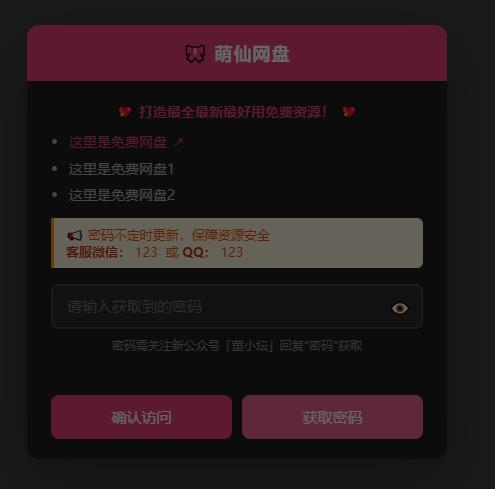
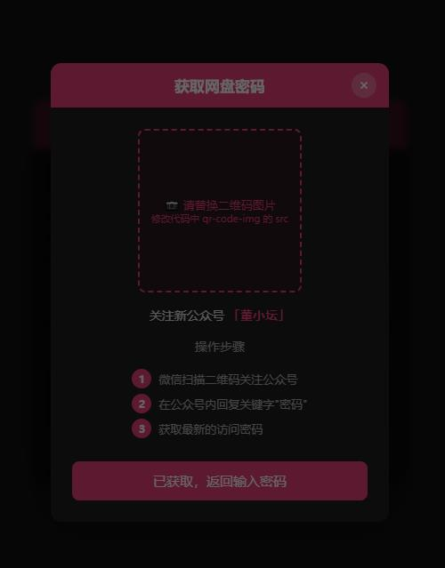

# OpenList 密码弹窗 — 萌仙网盘主题

一个专为 **OpenList / AList** 设计的密码访问弹窗，采用粉红色萌系主题，支持二维码获取密码、链接跳转等功能。

> 如果你用 OpenList 或 AList 搭建了网盘/资源站，想给网站加个「打开就弹密码框」的效果，直接复制代码即可使用。


---

## ✨ 效果预览

打开网站时，未授权用户会看到：

### 密码输入弹窗



### 二维码获取密码弹窗



### 底部备案信息


### 页面点击爱国特效


- 🎀 粉红色主题密码弹窗
- 💖 居中高亮标题
- 🔗 可点击的网盘链接
- 📢 客服信息提示
- 🔒 密码输入验证
- 📱 点击「获取密码」弹出二维码窗口
- 📋 底部 ICP + 公安备案信息替换
- 🎆 页面点击爱国特效（爱心 + 爱国文字飘浮）

---

## 🚀 快速使用

### 1. 密码弹窗

把 `openlist-password-popup.html` 文件里的**全部内容**复制，粘贴到 OpenList 后台「**设置 → 全局 → 自定义头部**」。

### 2. 底部备案信息（可选）

把 `openlist-custom-footer.html` 文件里的**全部内容**复制，同样粘贴到「**设置 → 全局 → 自定义头部**」。

> 可以同时粘贴密码弹窗和底部备案的代码，它们互不冲突。

### 3. 页面点击爱国特效（可选）

把 `openlist-click-effect.html` 文件里的**全部内容**复制，同样粘贴到「**设置 → 全局 → 自定义头部**」。

> 在页面任意位置点击，会出现红色爱心 + 爱国文字飘浮效果。

### 4. 刷新页面

回到前台首页，按 `Ctrl + F5` 强制刷新，即可看到效果。

---

## ⚙️ 必改配置

### 密码弹窗

在 `openlist-password-popup.html` 的配置区修改：

```javascript
const CONFIG = {
  // 1. 访问密码（必须改成你自己的！）
  PASSWORD: "mxwlcm",

  // 2. 二维码图片链接（必须替换成你的公众号二维码！）
  QR_CODE_URL: "https://your-domain.com/path/to/qrcode.png",

  // 3. 免费网盘链接（把 href 改成你的实际链接）
  <a href="https://example.com/pan1" target="_blank">这里是免费网盘 ↗</a>
};
```

> ⚠️ **不修改密码的话，任何人输入 `mxwlcm` 都能进入！**

### 底部备案

在 `openlist-custom-footer.html` 的配置区修改：

```javascript
const FOOTER_CONFIG = {
  // ICP 备案号（没有则留空字符串 ""）
  ICP_NUMBER: "京ICP备XXXXXXXX号-1",

  // ICP 备案图标链接（可选）
  ICP_ICON: "",

  // 公安备案号（没有则留空字符串 ""）
  GONGAN_NUMBER: "京公网安备XXXXXXXXXXXXXX号",

  // 公安备案图标链接（可选）
  GONGAN_ICON: ""
};
```

---

## 🎨 自定义内容

### 密码弹窗

| 位置      | 说明                                    |
| ------- | ------------------------------------- |
| 弹窗标题    | `.pwd-modal-header` 中的文字              |
| 高亮标题    | `.highlight` 中的文字                     |
| 列表项     | `<li>` 标签中的文字和链接                      |
| 客服微信/QQ | `.pwd-tip` 中的联系方式                     |
| 公众号名称   | `.pwd-sub-text` 和 `.qr-gzh-text` 中的名称 |
| 操作步骤    | `.qr-steps` 中的步骤说明                    |

### 底部备案

| 位置      | 说明                    |
| ------- | --------------------- |
| ICP 备案号 | `ICP_NUMBER` 配置项      |
| ICP 图标  | `ICP_ICON` 配置项（可选）    |
| 公安备案号   | `GONGAN_NUMBER` 配置项   |
| 公安备案图标  | `GONGAN_ICON` 配置项（可选） |

---

## 🛠️ 功能说明

### 密码验证

- 输入正确密码后，弹窗消失，可正常访问网站
- 验证通过后 **24 小时内**不再弹窗（基于浏览器 localStorage）
- 关闭浏览器重新打开后需要再次输入密码

### 二维码弹窗

- 点击「获取密码」按钮弹出二维码窗口
- 显示公众号二维码 + 操作步骤（扫码 → 回复关键词 → 获取密码）
- 支持点击背景或关闭按钮返回密码输入界面

### 显示/隐藏密码

- 输入框右侧有眼睛图标，可切换明文/密文显示

### 页面点击爱国特效

- 在页面任意位置点击，出现红色爱心 + 爱国文字飘浮
- 随机内容：❤️💖💗 / "我爱中国" / "祖国万岁" / "🇨🇳" 等
- 随机大小、随机飘动方向
- 自动消失，不影响页面操作

### 底部备案替换

- 保留原生 `.footer` 的 DOM 位置，不遮挡页面内容
- 第一行：ICP 备案 | 公安备案（图标 + 文字）
- 第二行：由 OpenList 驱动 | 管理后台
- 两行以 `|` 分隔符为中心垂直对齐
- SPA 路由切换时自动保持替换效果

---

## 📁 项目结构

```
.
├── openlist-password-popup.html   # 密码弹窗代码（粘贴到自定义头部）
├── openlist-custom-footer.html    # 底部备案代码（粘贴到自定义头部）
├── openlist-click-effect.html     # 页面点击爱国特效（粘贴到自定义头部）
├── assets/
│   ├── 密码.jpg                    # 密码弹窗预览图
│   ├── 二维码.jpg                  # 二维码弹窗预览图
│   ├── 底部.jpg                    # 底部备案预览图
│   └── 点击效果.jpg                # 点击特效预览图
├── README.md                      # 本文件
├── .gitignore                     # Git 忽略规则
└── LICENSE                        # MIT 许可证
```

---

## 📝 技术说明

- **纯前端实现**：不修改 OpenList 后端代码，通过「自定义头部」注入
- **无侵入性**：OpenList 版本升级不受影响
- **响应式设计**：适配手机和电脑
- **暗黑模式**：自动跟随系统主题

---

## 🤝 适用场景

- 网盘资源站密码保护
- 公众号引流（扫码关注获取密码）
- 限制访客访问的私有文件列表
- 临时分享链接的访问控制

---

## 📄 许可证

MIT License — 自由使用、修改和分发。

---

> 如果对你有帮助，欢迎点个 ⭐ Star！
